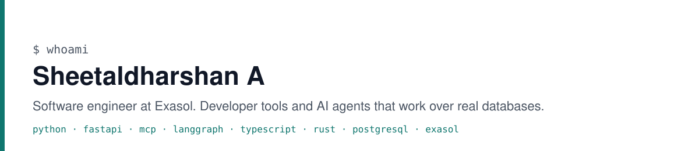

<picture>
  <source media="(prefers-color-scheme: dark)" srcset="banner-dark.svg">
  
</picture>

I am a software engineer at [Exasol](https://www.exasol.com). I build developer tools and AI agents that work over real databases, and I care about the part most demos skip: the installer that has to work on a stranger's laptop, the read-only login that cannot be misused, the SQL you get to see before it runs.

This is my personal account. The work from the last few months lives on my work account, [@Sheetaldharshan200](https://github.com/Sheetaldharshan200).

## Now

**[Exasol Personal Local Starter Kit](https://github.com/exasol-labs/exasol-personal-local-starterkit)**, co-built with one other engineer. One command puts an analytics database on your laptop, loads sample data, and connects Claude, Codex or Cursor to it through MCP. My parts: the MCP access and client-config subsystem, the guided data loader, Windows parity, the Linux self-repair paths, update and uninstall. Two releases so far.

**[Exasol Studio](https://github.com/Sheetaldharshan200/Exasol-studio)**, a personal project. A desktop app for Exasol with an AI assistant that reads your schema, writes the SQL, shows it to you, and asks before it changes anything. Tauri 2 and Rust shell, React 19, a LangGraph agent runtime, an MCP gateway. Signed builds for macOS, Windows and Linux. A 47-case eval suite gates each release. [Releases](https://github.com/Sheetaldharshan200/Exasol-studio/releases).

## Before that

A year as an AI intern at Prayag.AI, building the backend and the LLM interview agent of a recruitment system (FastAPI, OpenAI Agents SDK, LangChain, Qdrant, Kafka, PostgreSQL) and an audit agent that reconciles Tally ERP data across 21 checkpoints. That code is the company's, so it is not here.

I built the system behind [An Autonomous Hiring Intelligence Using Goal-oriented AI Agents and Dynamic Skill Inference](https://doi.org/10.1109/ICMLAS67792.2026.11483816), IEEE ICMLAS 2026. My co-authors wrote the paper.

## College work that is still worth a look

| Repo | What it is | Notes |
|---|---|---|
| [signsense](https://github.com/SHEETALDHARSHAN-A/signsense) | Indian Sign Language learning app. A deep-learning model on OpenCV reads signs from the camera and grades the learner | Team of four, I was tech lead and built the model. Second place, All-India hackathon, Sengunthar Engineering College, 2025 |
| [ClaimIt](https://github.com/SHEETALDHARSHAN-A/ClaimIt) | Lost-and-found app with photo-based ownership checks and a trust-points system | Django, MySQL. Team of four, tech lead |
| [Heart-Disease-prediction](https://github.com/SHEETALDHARSHAN-A/Heart-Disease-prediction) | Bagging over Random Forest, KNN and logistic regression on the UCI dataset. 94% with cross-validation | scikit-learn, solo |
| [neetcode-submissions](https://github.com/SHEETALDHARSHAN-A/neetcode-submissions) | DSA practice, mostly Python | Ongoing |

## How I work

- The agent shows the SQL before it runs it. Always.
- Nothing ships without an eval or a test that would have caught the last bug.
- An installer that needs a human to fix it afterwards is not finished.

## Elsewhere

[LinkedIn](https://www.linkedin.com/in/sheetaldharshan) · [sheetaldharshan.me](https://sheetaldharshan.me) · sheetaldharshan@gmail.com
